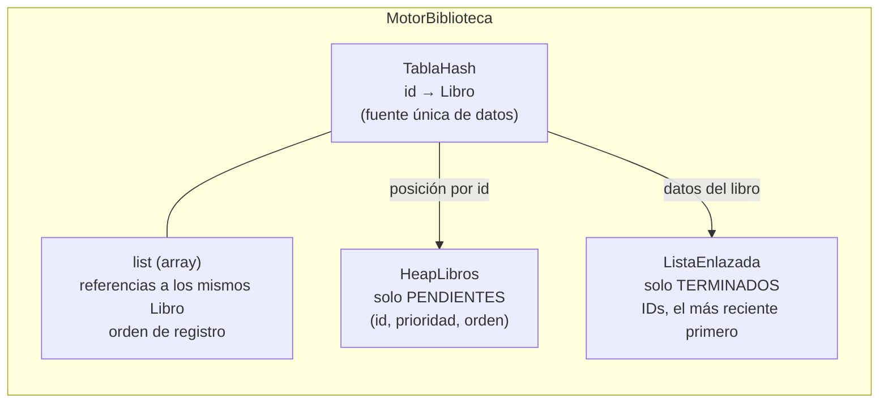
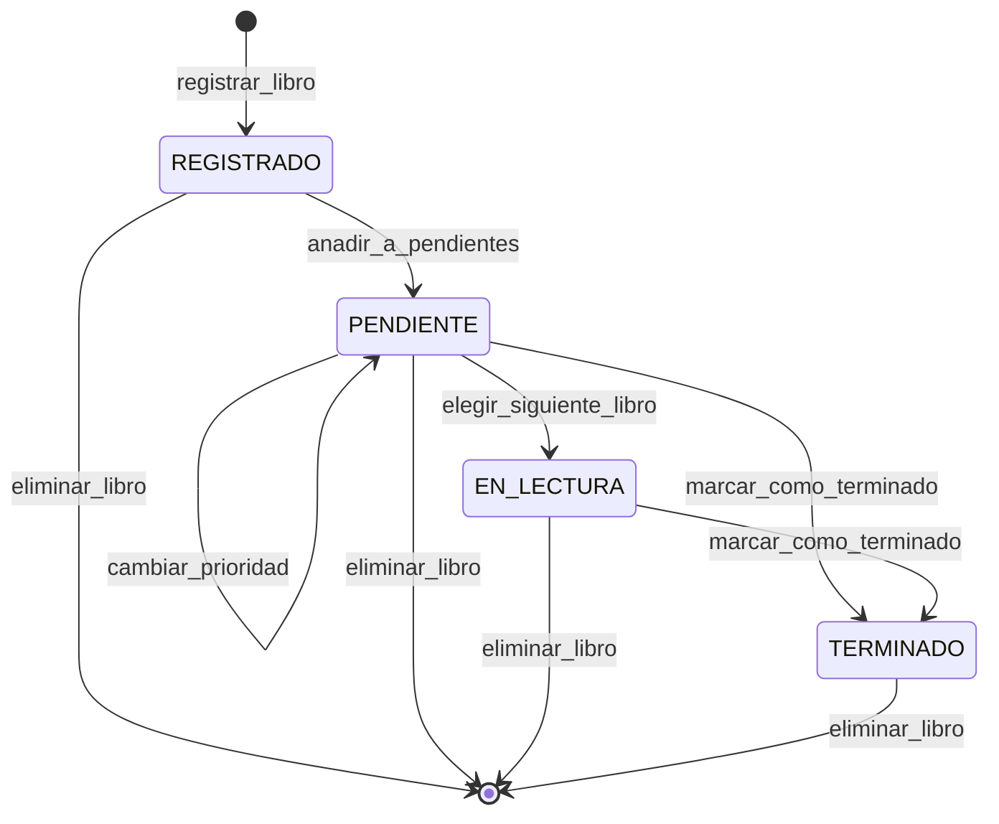
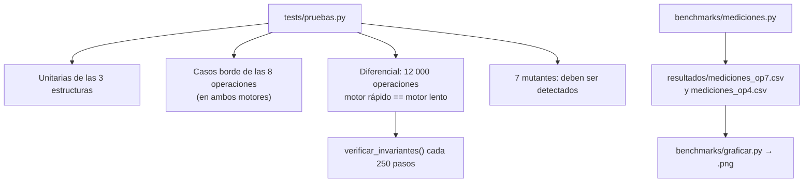

# Flujo del código — Motor de la Biblioteca personal

Este documento explica cómo está armado el motor y qué pasa por dentro en cada operación. Está escrito para que cualquier integrante del equipo pueda seguirlo sin haber escrito esa parte.

## 1. Mapa de archivos

| Archivo | Qué contiene |
| --- | --- |
| `src/libro.py` | Tipos: `Libro`, `EstadoLibro`, `EntradaHeap`, resultados de operaciones y la regla de prioridad `tiene_mayor_prioridad`. |
| `src/tabla_hash.py` | `TablaHash` propia (Hashing). |
| `src/heap_libros.py` | `HeapLibros` propio (Árboles). |
| `src/lista_enlazada.py` | `ListaEnlazada` simple propia (Secuencias). |
| `src/motor_biblioteca.py` | `MotorBiblioteca`: junta las estructuras y expone las operaciones. |
| `src/motor_lento.py` | `MotorBibliotecaLento`: lo mismo con listas simples y búsquedas lineales. |
| `tests/pruebas.py` | Pruebas, comparación diferencial y mutantes. |
| `benchmarks/` | Mediciones, gráficas y resultados. |

## 2. Arquitectura y sincronización entre estructuras

### Reglas de sincronización

1. La tabla hash y el array apuntan al **mismo objeto** `Libro`; no hay copias.
2. El heap guarda solo `(id, prioridad, orden)`. La lista enlazada guarda solo IDs. Los datos del libro viven en un único lugar: la tabla hash.
3. Los libros en estado `PENDIENTE` son exactamente los que están en el heap, con la misma prioridad y el mismo orden de llegada.
4. Los libros en estado `TERMINADO` son exactamente los IDs de la lista enlazada, sin repetir.
5. Ningún libro `REGISTRADO` o `EN_LECTURA` está en el heap ni en la lista.

`MotorBiblioteca.verificar_invariantes()` comprueba estas reglas y los invariantes de cada estructura.

### Regla de prioridad

Se elige primero la **mayor prioridad** (entero de 1 a 10). Si empatan, sale el que **entró antes** a pendientes (menor `orden_pendiente`). Cambiar la prioridad **no** cambia el orden de llegada.

## 3. Ciclo de vida de un libro

Un libro `TERMINADO` no se puede terminar de nuevo ni volver a pendientes.

## 4. Flujo detallado de las operaciones

Todas las operaciones devuelven un objeto de resultado (`ResultadoOperacion`, `ResultadoBusqueda`, `ResultadoSiguiente` o `ResultadoLista`) y **devuelven copias** de los libros, para que quien llama no pueda dañar el estado interno. Un ID válido es un texto no vacío.

### Operación 1: `registrar_libro(id, titulo, autor)`
1. Rechaza si algún campo no es texto no vacío.
2. Rechaza si el ID ya existe en la tabla hash.
3. Crea el `Libro` en estado `REGISTRADO`, lo inserta en la tabla hash y lo agrega al final del array.

### Operación 2: `buscar_libro(id)`
1. Rechaza IDs que no son texto no vacío.
2. Busca en la tabla hash. Si no está, devuelve "no encontrado".
3. Devuelve una copia del libro. No cambia nada.

### Operación 3: `anadir_a_pendientes(id, prioridad)`
1. Valida primero la prioridad (entero de 1 a 10, sin aceptar `bool`).
2. Busca el libro; rechaza si no existe.
3. Rechaza si ya está pendiente (no se duplica) o si no está `REGISTRADO`.
4. Sube el contador de llegada, cambia el estado a `PENDIENTE`, guarda prioridad y orden en el libro e inserta la entrada en el heap.

### Operación 4: `cambiar_prioridad(id, nueva)`
1. Valida la prioridad, busca el libro y comprueba que esté `PENDIENTE`.
2. Actualiza la prioridad en el libro y pide al heap `actualizar_prioridad`, que busca la posición en su tabla hash y sube o baja la entrada.

### Operación 5: `elegir_siguiente_libro()`
1. Pide al heap `extraer_maximo`. Si está vacío, devuelve "no disponible".
2. Busca el libro por el ID de la entrada y lo pasa a `EN_LECTURA`.

### Operación 6: `marcar_como_terminado(id)`
1. Busca el libro; rechaza si no existe o si no está `EN_LECTURA` ni `PENDIENTE`.
2. Si estaba `PENDIENTE`, lo saca del heap con `eliminar_por_id`.
3. Cambia el estado a `TERMINADO` e inserta su ID al inicio de la lista enlazada.

### Operación 7: `mostrar_lecturas_recientes(k)`
1. Rechaza `k` que no sea entero (ni `bool`) o sea negativo. Con `k = 0` devuelve vacío.
2. Recorre la lista desde la cabeza hasta `k` IDs (sin modificarla) y busca cada libro en la tabla hash.

### Operación 8: `listar_coleccion_por_titulo()`
1. Ordena una copia del array con la clave `(titulo.casefold(), id)`.
2. Devuelve copias de los libros. La colección original no cambia.

### Operación auxiliar: `eliminar_libro(id)`
1. Si estaba `PENDIENTE`, lo saca del heap. Si estaba `TERMINADO`, lo saca de la lista enlazada (hay que recorrerla).
2. Lo quita del array (por identidad del objeto) y de la tabla hash. El ID queda libre.

Otras auxiliares: `existe_libro`, `contar_libros`, `contar_pendientes`, `contar_terminados`, `listar_coleccion` (orden de registro).

## 5. Estructuras propias en breve

- **TablaHash:** 16 cubetas al inicio; cada cubeta es una lista de pares `(clave, valor)`. Si el factor de carga pasaría de 0.75, duplica la capacidad y reubica todo (rehash). Rechaza claves `bool` para que `True` y `1` no se confundan.
- **HeapLibros:** arreglo que representa un árbol binario completo (hijos de `i` en `2i+1` y `2i+2`). Una `TablaHash` guarda `id → posición` para encontrar una entrada sin recorrer el heap. Eliminar por ID intercambia con la última entrada y luego sube o baja.
- **ListaEnlazada:** nodos `(valor, siguiente)`. Insertar al inicio cambia solo la cabeza. Eliminar un valor obliga a recorrer guardando el nodo anterior.

## 6. Verificación y mediciones

El motor lento no usa ninguna estructura propia: solo listas de Python y recorridos lineales. Por eso es fácil de revisar a mano y sirve para comprobar al motor rápido. Las mediciones comprueban primero que los dos candidatos de cada operación dan las mismas respuestas.
