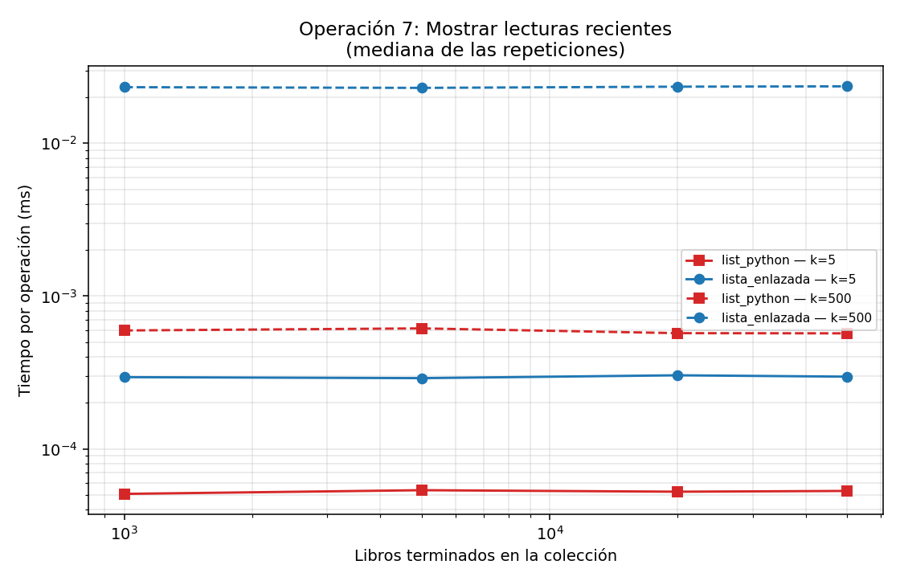
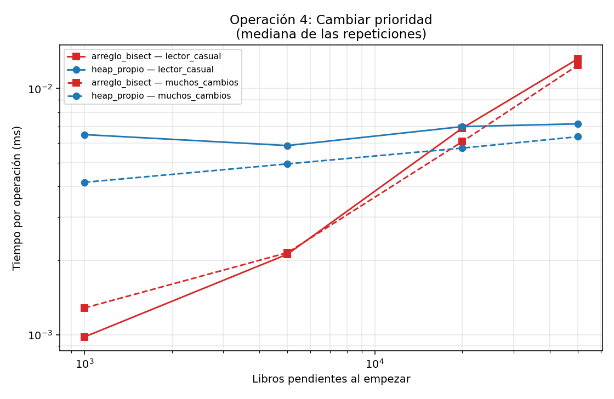

# Informe del proyecto: motor de la Biblioteca personal

**Curso:** CMP3002 Estructuras de Datos, sección 1640 — Proyecto 1
**Autoras:** Laura Reyes, Amelie Robalino y Andreina Rosales
**Fecha de entrega:** 29 de noviembre de 2026

**Resumen.** Diseñamos y programamos en Python el motor de una biblioteca personal: guarda libros, lleva una lista de pendientes con prioridad, elige qué leer a continuación y recuerda las lecturas recientes. El motor usa tres familias de estructuras (Hashing, Árboles y Secuencias); la tabla hash y el heap son propios, con sus invariantes comprobados por pruebas. Comparamos cada operación contra sus candidatos, medimos dos operaciones (lecturas recientes y cambiar prioridad) y comprobamos el motor contra una versión lenta con 12 000 operaciones aleatorias. Las mediciones confirmaron una parte del análisis y contradijeron otra; lo explicamos en la sección 4.

---

## 1. La app y sus operaciones

**La app.** Una biblioteca personal para una sola persona. Registra los libros que tiene, marca cuáles quiere leer y con qué prioridad, le dice cuál leer ahora, guarda qué terminó y muestra su colección. No usa datos personales reales; los libros son identificadores y textos inventados.

**Estados de un libro:** `REGISTRADO` (existe en la colección), `PENDIENTE` (quiere leerlo, con prioridad de 1 a 10), `EN_LECTURA` y `TERMINADO`.

**Regla de prioridad.** Se elige primero la mayor prioridad. Si empatan, el que entró antes a pendientes. Cambiar la prioridad no cambia el orden de llegada.

**Casos borde decididos (y probados).** Un ID es válido si es texto no vacío. Un ID inexistente o inválido se rechaza sin cambiar nada; un ID repetido al registrar se rechaza; una prioridad fuera de 1 a 10, no entera, o `True`/`False`, se rechaza; con el motor vacío, elegir siguiente devuelve "no disponible" y listar devuelve vacío. Todas las operaciones devuelven copias de los libros.

| # | Operación | Entradas | Devuelve | Qué cambia | Casos borde |
| --- | --- | --- | --- | --- | --- |
| 1 | Registrar libro | ID, título, autor | éxito o error | Agrega el libro (`REGISTRADO`) | Campos vacíos o no texto; ID repetido |
| 2 | Buscar libro | ID | el libro o "no encontrado" | Nada | ID vacío, inválido o inexistente |
| 3 | Añadir a pendientes | ID, prioridad | éxito o error | Pasa a `PENDIENTE` | Prioridad inválida; ID inexistente; ya pendiente; no está `REGISTRADO` |
| 4 | Cambiar prioridad | ID, nueva prioridad | éxito o error | Cambia la prioridad, no el orden de llegada | Prioridad inválida; ID inexistente; no está pendiente |
| 5 | Elegir siguiente | — | el libro elegido o "no disponible" | Sale de pendientes y pasa a `EN_LECTURA` | Sin pendientes |
| 6 | Marcar como terminado | ID | éxito o error | Pasa a `TERMINADO` y se guarda como lectura reciente; si era pendiente, sale de pendientes | ID inexistente; `REGISTRADO` o ya `TERMINADO` |
| 7 | Mostrar lecturas recientes | k | hasta k libros, el más reciente primero | Nada | k negativo o no entero (error); k = 0 (vacío); k mayor que los terminados (los que haya) |
| 8 | Listar colección por título | — | todos los libros ordenados (título sin distinguir mayúsculas, luego ID) | Nada | Colección vacía |

**Operaciones auxiliares (se implementan y prueban, no se analizan):** eliminar libro, contar libros, contar pendientes, contar terminados, preguntar si existe un ID y listar la colección en orden de registro.

---

## 2. Las operaciones que cuentan

La operación 1 (registrar) **no cuenta**: guardar el libro por su ID y agregarlo al final tiene una respuesta obvia, no hay un candidato razonable que le gane. Para las otras siete comparamos candidatos:

| Operación | Candidato 1 (elegido) | Candidato 2 (y otros) | Cuándo gana cada uno |
| --- | --- | --- | --- |
| 2. Buscar por ID | `TablaHash` propia | Array ordenado por ID con búsqueda binaria | La tabla hash gana cuando se registran libros entre las búsquedas (insertar ordenado en el array cuesta O(n)). El array ordenado gana en espacio (n referencias, sin cubetas ni factor de carga) y cuando la colección ya está cargada y casi no cambia. La ventaja del array es de constante. |
| 3. Añadir a pendientes | Heap propio | Array ordenado por (prioridad, orden) con `bisect` | El array gana con pocos pendientes (constante pequeña). El heap gana con muchos, porque insertar en el array desplaza O(p) elementos mientras el heap sube O(log p) niveles. Solo análisis; no la medimos. |
| 4. Cambiar prioridad | Heap propio con índice id → posición | Array ordenado con `bisect` y diccionario id → clave | El array gana con pocos pendientes (1.0 µs contra 6.5 µs con 1 000). El heap gana con muchos (6.4 a 7.2 µs contra 12.4 a 13.2 µs con 50 000). Medido, ver sección 4. |
| 5. Elegir siguiente | Heap propio | Array sin ordenar, con diccionario id → posición, que busca el máximo recorriendo todo; y array ordenado (el mejor queda al final) | Contra el array sin ordenar: este gana con pocos pendientes (añadir y cambiar cuestan O(1) y recorrer pocos elementos es barato) y el heap con muchos (O(log p) contra O(p)). Contra el array ordenado, elegir cuesta O(1) y le gana al heap; a cambio el ordenado paga O(p) al añadir y cambiar. Solo análisis; no la medimos. |
| 6. Marcar como terminado | Lista enlazada (inserción en la cabeza) | Array con `append`; array con `insert(0, x)` | La lista gana contra `insert(0, x)` cuando hay muchos terminados (O(1) contra O(n)) y gana en el peor caso por operación, porque nunca copia el arreglo. El array con `append` gana en tiempo real medido, porque es amortizado O(1) con constante pequeña. |
| 7. Mostrar lecturas recientes | Lista enlazada (recorrer desde la cabeza) | Array con `append` leído desde el final; array con `insert(0, x)` | Mismo caso que la operación 6: la lista le gana a `insert(0, x)` si hay muchos terminados; el array con `append` leído al revés gana en tiempo medido (ver sección 4). |
| 8. Listar por título | Array + ordenar al listar (`sorted`) | AVL ordenado por título (no implementado) | El array gana cuando casi no se listan (registrar es O(1) contra O(log n)). El AVL gana cuando se lista seguido entre registros (listar es O(n) contra O(n log n)). Solo análisis teórico; no lo implementamos ni medimos. |

**Puntos débiles que reconocemos.** (a) Las operaciones 3, 4 y 5 comparten la misma estructura elegida (el heap) y se comparan contra variantes del arreglo; un evaluador podría contarlas como un solo diseño. (b) Las operaciones 6 y 7 comparten el mismo par. (c) En la operación 2 el array ordenado gana solo por una constante de espacio. (d) Contra el **arreglo ordenado**, la operación 5 la gana el arreglo por sí sola (sacar el último es O(1)); el heap solo le gana al arreglo sin ordenar. (e) Solo medimos las operaciones 7 y 4; las demás comparaciones son análisis teórico. Cada operación de la 2 a la 8 tiene dos candidatos que ganan en algún escenario, pero (a), (b) y (e) son las partes más discutibles.

---

## 3. Los escenarios

Los porcentajes son la mezcla de operaciones; las operaciones auxiliares no entran. Las operaciones 1 y 8 aparecen donde tiene sentido: la 1 en A y D, la 8 en todos los escenarios.

| Escenario | Mezcla | Datos | Forma de los datos |
| --- | --- | --- | --- |
| **A. Lector casual** | 38 % buscar, 15 % registrar, 15 % añadir a pendientes, 5 % cambiar prioridad, 10 % elegir, 10 % terminar, 5 % recientes (k = 5), 2 % listar por título | 200 libros | Prioridades al azar de 1 a 10 |
| **B. Colección grande, muchos cambios** | 58 % cambiar prioridad, 15 % añadir, 10 % elegir, 10 % buscar, 5 % recientes (k = 5), 2 % listar | 50 000 libros, gran parte pendientes | Prioridades al azar de 1 a 10 |
| **C. Revisión del historial** | 78 % recientes (k = 500), 10 % terminar, 10 % buscar, 2 % listar | 20 000 libros terminados | Casi sin registros nuevos |
| **D. Escenario corto (frontera)** | 50 % registrar, 50 % listar por título | 5 000 libros | Alguien que va armando su colección y la revisa ordenada en cada paso |

En cada escenario gana un candidato distinto: en A, los arreglos ordenados (pocos datos); en B, el heap en cambiar prioridad con colas grandes; en C, el array con `append` en tiempo real y la lista enlazada frente a `insert(0, x)`; en D, el AVL para la operación 8.

---

## 4. La comparación

### 4.1 Tiempo y espacio de cada candidato

n = libros en la colección, p = libros pendientes, t = libros terminados, k = lo pedido. "Amort." = amortizado; "esp." = esperado.

| Operación | Candidato | Tiempo (caso) | Espacio extra |
| --- | --- | --- | --- |
| 2. Buscar | Tabla hash | O(1) esp.; O(n) peor | O(n) (cubetas y nodos) |
| 2. Buscar | Array ordenado + búsqueda binaria | O(log n) peor | O(1) |
| 3. Añadir | Heap | O(log p) peor | O(p) (entradas + índice) |
| 3. Añadir | Array ordenado | O(p) peor (desplaza elementos) | O(p) (claves + diccionario) |
| 4. Cambiar prioridad | Heap indexado | O(log p) peor | O(1) |
| 4. Cambiar prioridad | Array ordenado | O(p) peor (borrar e insertar) | O(1) |
| 5. Elegir | Heap | O(log p) peor | O(1) |
| 5. Elegir | Array sin ordenar + recorrido | O(p) (se recorre todo) | O(p) (diccionario de posiciones) |
| 5. Elegir (ref.) | Array ordenado | O(1) (se saca el último) | O(1) |
| 6. Terminar | Lista enlazada | O(1) peor (más sacar del heap si era pendiente) | O(t) (un nodo por libro) |
| 6. Terminar | Array con `append` | O(1) amort.; O(t) en el peor | O(t) |
| 7. Recientes | Lista enlazada | O(k) | O(k) para la respuesta |
| 7. Recientes | Array con `append` leído al revés | O(k) | O(k) para la respuesta |
| 8. Listar | Array + `sorted` | O(n log n) | O(n) (copia) |
| 8. Listar | AVL por título | O(n) en orden | O(n) (nodos del árbol) |

En las tablas se cuenta además una búsqueda en la tabla hash (O(1) esperado) por cada libro devuelto.

### 4.2 Costo total por escenario (análisis)

Por escenario, qué candidato cuesta menos según la mezcla (análisis, no medición):

| Escenario | Cola de pendientes (3, 4, 5) | Lecturas recientes (6, 7) | Listar por título (8) |
| --- | --- | --- | --- |
| A (200 libros) | Arreglo ordenado: con p pequeño, desplazar pocos elementos cuesta menos que las constantes del heap | Array con `append` | Array + `sorted`; con 2 % de listados el AVL no compensa |
| B (50 000) | Heap: 58 % de cambios, cada uno O(log p) contra O(p); pero elegir (15 %) favorece al arreglo ordenado (O(1)); el costo total de la cola no se midió | Poco peso (5 %) | Poco peso (2 %) |
| C (20 000 terminados) | Poco peso | Domina k = 500: ambos O(k); gana el array por constante | Poco peso |
| D (5 000) | No participa | No participa | AVL: cada listado O(n) contra O(n log n) del `sorted` |

### 4.3 Mediciones

Medimos **dos operaciones** (la 7 y la 4), cada una con sus candidatos implementados (el que no elegimos usa estructuras del lenguaje). Antes de cada medición el programa comprueba que ambos candidatos dan las mismas respuestas; si no, se detiene. Medimos tiempo con `time.perf_counter_ns`, con el recolector de basura apagado durante la medición y la misma máquina para todo. **Unidad: microsegundos (µs) por operación.** Cada punto se repite 7 veces; las tablas de este informe muestran la mediana en µs. Cada CSV (`benchmarks/resultados/mediciones_op7.csv` y `mediciones_op4.csv`) guarda una fila por escenario, tamaño y candidato, con las columnas `escenario, tamano_v, candidato, repeticiones, promedio_ms, mediana_ms`; los CSV están en milisegundos (1 ms = 1 000 µs). Semilla fija 2026. Entorno en `benchmarks/resultados/entorno.txt`.

#### Operación 7: Mostrar lecturas recientes (lista enlazada propia contra `list` de Python)

Escenarios: pedir k = 5 (mirar lo último) y k = 500 (repasar el historial). Tamaños: 1 000, 5 000, 20 000 y 50 000 libros terminados. Cada repetición hace 2 000 consultas.

| Libros terminados | k=5 lista enlazada | k=5 `list` | k=500 lista enlazada | k=500 `list` |
| --- | --- | --- | --- | --- |
| 1,000 | 0.29 | 0.05 | 23.3 | 0.60 |
| 5,000 | 0.29 | 0.05 | 23.1 | 0.61 |
| 20,000 | 0.30 | 0.05 | 23.5 | 0.57 |
| 50,000 | 0.30 | 0.05 | 23.6 | 0.57 |



**¿Confirma el análisis?** *En parte.* Confirma que el costo depende de k y no de n: las líneas son planas al crecer el tamaño, y con k = 500 cuesta unas 80 veces más que con k = 5 en la lista enlazada. **Contradice** la idea de que la lista enlazada tenga alguna ventaja práctica: la `list` de Python es unas 6 veces más rápida con k = 5 y unas 40 veces con k = 500. El análisis O(k) trata los dos recorridos como iguales, pero recortar una `list` lo hace código en C de una sola vez, mientras que recorrer nuestra lista salta nodo por nodo en Python. Es una diferencia de constantes, no de crecimiento.

#### Operación 4: Cambiar prioridad (heap indexado propio contra arreglo ordenado con `bisect`)

Escenarios de medición (propios de la cola de pendientes, distintos de los escenarios A a D de la sección 3, que mezclan todas las operaciones): A' "lector casual" (45 % añadir, 10 % cambiar prioridad, 45 % elegir) y B' "muchos cambios" (15 % añadir, 70 % cambiar, 15 % elegir). El tamaño es la cantidad de libros pendientes al empezar: 1 000, 5 000, 20 000 y 50 000; cada repetición aplica 3 000 operaciones. Se mide solo el tiempo de la operación "cambiar prioridad".

| Pendientes al empezar | A' heap | A' arreglo + bisect | B' heap | B' arreglo + bisect |
| --- | --- | --- | --- | --- |
| 1,000 | 6.49 | 0.98 | 4.16 | 1.28 |
| 5,000 | 5.86 | 2.12 | 4.94 | 2.15 |
| 20,000 | 7.00 | 6.90 | 5.72 | 6.08 |
| 50,000 | 7.18 | 13.2 | 6.37 | 12.4 |



**¿Confirma el análisis?** *Sí.* El arreglo crece casi en línea recta (de 1 µs a 13 µs al pasar de 1 000 a 50 000), el heap se mantiene casi plano (de 6.5 µs a 7.2 µs en el escenario A', y de 4.2 µs a 6.4 µs en B'), y se cruzan alrededor de 20 000 pendientes (en ese tamaño los dos quedan casi empatados). Con pocos pendientes gana el arreglo porque la constante del heap (comparaciones con una función de Python, actualizar el índice en la tabla hash) pesa más que desplazar pocos elementos, como anticipamos.

#### Lo que no medimos

No medimos el costo total de la cola de pendientes (añadir, cambiar y elegir juntos), así que no tenemos datos propios de si el heap es la opción más barata en conjunto. La medición de la operación 4 muestra que el heap gana en cambiar prioridad solo con colas grandes (cerca de 20 000 pendientes o más). Elegimos el heap por su costo O(log p) garantizado en las tres operaciones de la cola, no porque lo hayamos medido como el más rápido.

---

## 5. El motor completo

### 5.1 Estructuras y qué guarda cada una

| Estructura | Familia | Qué guarda |
| --- | --- | --- |
| `TablaHash` propia (id → `Libro`) | Hashing | Cada libro, una sola vez. Es la fuente única de los datos. |
| `list` de Python (array) | Secuencias | Referencias a los mismos objetos `Libro`, en orden de registro. Sirve para la operación 8. |
| `HeapLibros` propio (con una `TablaHash` id → posición) | Árboles | Solo los libros `PENDIENTE`: `(id, prioridad, orden)`. |
| `ListaEnlazada` propia | Secuencias | Solo los IDs de los libros `TERMINADO`, el más reciente primero. |

La tabla hash y el array apuntan al mismo objeto (no hay copias). El heap y la lista guardan solo identificadores, para que los datos del libro no se desincronicen. `verificar_invariantes()` comprueba que los pendientes sean exactamente los del heap (con la misma prioridad y orden) y los terminados exactamente los de la lista, sin repetir.

### 5.2 Costo de mantener las estructuras juntas

Como las estructuras comparten los libros, cada cambio de estado toca varias a la vez, y ese costo cuenta:

| Operación | Estructuras que toca | Costo |
| --- | --- | --- |
| 1. Registrar | Tabla hash + array | O(1) esperado + O(1) amortizado |
| 3. Añadir a pendientes | Libro + heap (y su índice) | O(log p) |
| 4. Cambiar prioridad | Libro + heap | O(log p) |
| 5. Elegir siguiente | Heap + libro | O(log p) |
| 6. Terminar | Si era pendiente: heap; luego lista | O(log p) si era pendiente; O(1) si estaba en lectura |
| 7. Recientes | Lista + tabla hash (k búsquedas) | O(k) esperado |
| 8. Listar por título | Array (copia y ordena) | O(n log n) |
| Aux. Eliminar libro | Tabla hash + array + heap o lista | O(n) por el array y, si estaba terminado, por recorrer la lista simple |

### 5.3 Tiempo y espacio de cada operación del motor

| Operación | Tiempo | Espacio extra |
| --- | --- | --- |
| 1. Registrar | O(1) esperado (hash) + O(1) amortizado (array) | O(1) por libro |
| 2. Buscar | O(1) esperado; O(n) en el peor caso (todas las claves en una cubeta) | O(1) |
| 3. Añadir a pendientes | O(log p) | O(1) por pendiente |
| 4. Cambiar prioridad | O(log p) | O(1) |
| 5. Elegir siguiente | O(log p) | O(1) |
| 6. Marcar terminado | O(1) o O(log p) | O(1) por terminado |
| 7. Mostrar recientes | O(k) | O(k) |
| 8. Listar por título | O(n log n) | O(n) |

El espacio total del motor es O(n): la tabla hash y el array guardan n libros (el array solo referencias), y el heap y la lista guardan, juntos, a lo más n entradas más el índice de posiciones.

### 5.4 Qué cambiaríamos en otro escenario

- **Colección pequeña o pocos pendientes (escenario A):** usar un arreglo ordenado en vez del heap; es más simple y en la medición de la operación 4 fue más rápido con 1 000 y 5 000 pendientes.
- **Colección grande con muchos cambios de prioridad (escenario B):** mantener el heap indexado; en la medición de la operación 4 gana desde cerca de 20 000 pendientes.
- **Se lista seguido la colección ordenada (escenario D):** cambiar la operación 8 a un AVL por título para que listar cueste O(n).
- **Historial muy largo y consultas con k grande:** si solo importa la velocidad en Python, el array con `append` leído al revés; mantendríamos la lista enlazada si importara que ninguna operación copie memoria.

---

## 6. La implementación y las pruebas

### 6.1 Propiedades que siempre cumplen las estructuras propias

**`TablaHash`:** (1) la cantidad de cubetas es la capacidad y es positiva; (2) el factor de carga no pasa de 0.75; (3) la suma de los largos de las cubetas es la cantidad de claves; (4) cada clave está en la cubeta que dicta su hash; (5) no hay claves repetidas. Se comprueba con `verificar_invariante()`.

**`HeapLibros`:** (1) su tabla de posiciones cumple su invariante; (2) el arreglo y la tabla tienen el mismo tamaño; (3) para todo índice `i`, la posición guardada del ID de `_datos[i]` es `i`; (4) ningún nodo tiene mayor prioridad que su padre, según la regla de prioridad. Se comprueba con `verificar_invariante()`.

**`ListaEnlazada`:** recorrer desde la cabeza visita exactamente `tamaño` nodos, no hay ciclos y, si el tamaño es 0, la cabeza es nula.

### 6.2 Las pruebas (`tests/pruebas.py`)

1. **Unitarias** de la tabla hash (rehash con 1 000 claves, sobrescritura, borrado, colisiones forzadas, rechazo de `bool`), la lista enlazada (insertar, leer k sin modificar, eliminar en cabeza, medio y cola) y el heap (desempate, actualizar, eliminar por ID, 500 elementos comparados contra un orden de referencia).
2. **Casos borde de las 8 operaciones** y de eliminar libro, en los dos motores: IDs vacíos o inexistentes, prioridades inválidas, `k` inválido, terminar dos veces, estados que no corresponden, colección vacía, reutilizar un ID eliminado.
3. **Invariantes del motor**, incluida la prueba de que se detecta una corrupción hecha a propósito (un libro pendiente marcado como `REGISTRADO` mientras sigue en el heap, y un heap con dos entradas intercambiadas).
4. **Prueba diferencial:** 12 000 operaciones aleatorias con semilla fija, contra la **versión lenta** (`MotorBibliotecaLento`, que usa solo listas y recorridos lineales y reescribe por su cuenta las validaciones y la regla de prioridad). Incluye IDs inexistentes, entradas inválidas, eliminar y reutilizar IDs. Se compara cada respuesta y, cada 250 pasos, los invariantes y los conteos. En esa corrida, la cantidad de pendientes en los 49 chequeos varió entre 0 y 16, con promedio de 4.9.
5. **Prueba difícil — mutantes:** rompimos el motor a propósito de 7 maneras, y la prueba diferencial detectó las 7: terminar un pendiente sin sacarlo del heap, cambiar prioridad sin reubicar, lecturas recientes con un libro de menos, orden por título que distingue mayúsculas, añadir a pendientes duplicando, desempate que elige el libro más nuevo, y eliminar un terminado sin sacarlo de la lista de recientes.

Para correrlas: `python tests/pruebas.py`.

---

## 7. Qué no demuestran nuestras pruebas y mediciones

**Pruebas**
- No demuestran que el motor sea correcto para toda entrada posible: coinciden con la versión lenta en 12 000 operaciones con una semilla fija.
- El motor lento y el rápido comparten los tipos de datos (`Libro`, estados, resultados) y fueron escritos por el mismo equipo; si entendimos mal una regla, la entendimos mal en los dos y la prueba no lo vería.
- Los 7 mutantes son los errores que se nos ocurrieron; otros errores podrían pasar sin ser detectados.
- Las mezclas aleatorias usan pocos pendientes a la vez (hasta 16 en los chequeos) y pocas prioridades distintas (1 a 10).
- No probamos concurrencia, errores de memoria ni colecciones de millones de libros.

**Mediciones**
- Se midieron en una sola computadora y una sola versión de Python (3.10.12); en otra máquina los números serán distintos.
- Se midieron las estructuras sueltas, no el motor completo con todas sus validaciones.
- Solo se midieron las operaciones 7 y 4. No medimos el espacio, ni las operaciones 3, 5, 6 y 8, ni eliminar libro; el AVL no está implementado, así que su comparación es solo teórica.
- La comparación de la lista enlazada contra `insert(0, x)`, la del heap contra el arreglo sin ordenar y la del AVL son solo análisis teórico; no las implementamos ni medimos.
- Los datos eran sintéticos y con prioridades al azar; una colección real puede tener otra forma.
- Los tamaños llegan a 50 000 libros; no medimos 10⁶.

---

## 8. Bibliotecas, herramientas y apoyos utilizados

- **Biblioteca estándar de Python:** `dataclasses`, `enum`, `typing`, `random`, `time`, `gc`, `bisect`, `csv`, `statistics`, `platform`, `os` y `sys`.
- **matplotlib:** solo para dibujar las gráficas.
- **Apuntes y lineamientos del curso CMP3002** (instrucciones del Proyecto 1 y de la Defensa).
- **Claude (asistente de IA de Anthropic):** nos ayudó a plantear las preguntas de diseño, a generar el código base de las estructuras, de los dos motores, de las pruebas y de las mediciones, y a redactar la documentación. El equipo revisó y ejecutó el código y las pruebas, y los números del informe vienen de corridas reales. *(Esta línea debe ajustarse a lo que cada integrante hizo realmente antes de entregar.)*
- No usamos código de otros repositorios para el motor de la biblioteca. Tomamos como referencia de formato el proyecto "Misiones de un videojuego" del propio equipo.

---

## Anexo: cómo reproducir

```bash
python tests/pruebas.py              # pruebas
python benchmarks/mediciones.py      # repite las mediciones (reescribe los 2 CSV)
python benchmarks/graficar.py        # redibuja las gráficas
```
