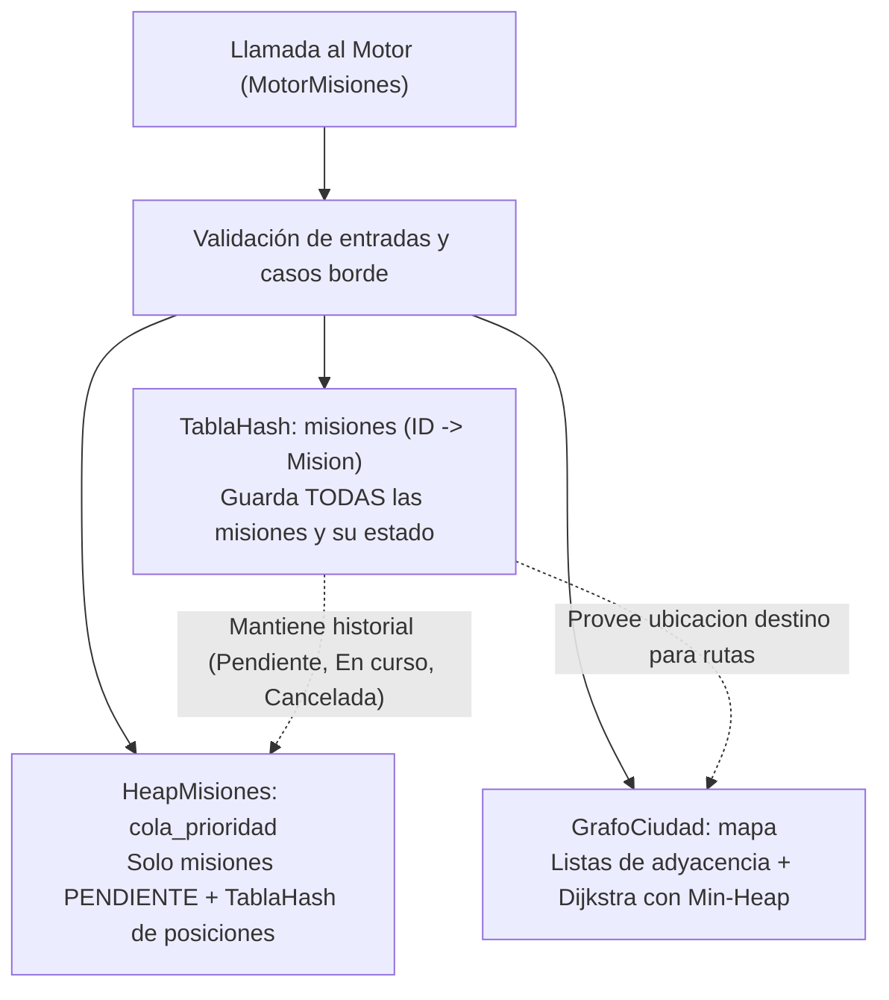
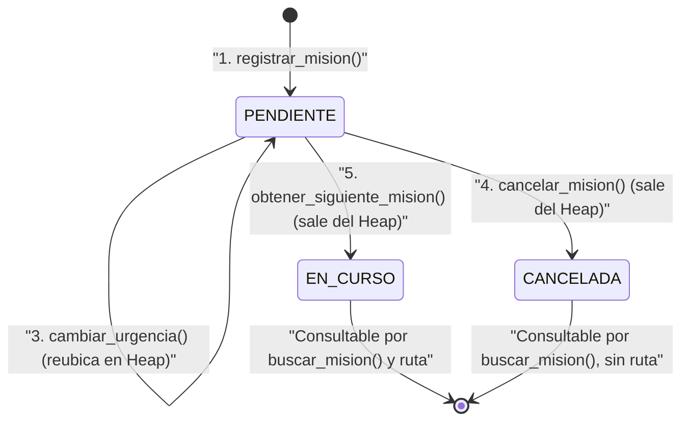

# Flujo del Código — Motor de Misiones de un Videojuego

Este documento describe paso a paso cómo está organizado el código en Python 3, cómo interactúan las tres estructuras de datos implementadas desde cero y cuál es el recorrido interno de cada una de las 7 operaciones del motor.

---

## 1. Mapa de archivos del proyecto

- [src/__init__.py](src/__init__.py): exporta las clases y utilidades públicas del paquete `src`.
- [src/mision.py](src/mision.py): define `TipoMision`, `EstadoMision`, el dataclass `Mision`, las constantes `URGENCIA_MIN = 1` y `URGENCIA_MAX = 10`, la regla de desempate `tiene_mayor_prioridad()`, la tupla `clave_orden_prioridad()` y los dataclasses de respuesta (`ResultadoOperacion`, `ResultadoBusqueda`, `ResultadoSiguiente`, `ResultadoTopK`, `ResultadoRuta`).
- [src/tabla_hash.py](src/tabla_hash.py): **Estructura propia #1 (Familia Hashing)**. Implementa `TablaHash` con encadenamiento separado, hash FNV-1a de 64 bits para cadenas (y SplitMix64 para enteros), factor de carga máximo `0.75`, `_rehash()` por duplicación y `verificar_invariante()`.
- [src/heap_misiones.py](src/heap_misiones.py): **Estructura propia #2 (Familia Árboles)**. Implementa `HeapMisiones` como un Max-Heap binario indexado con una `TablaHash` interna de posiciones (`id -> índice`), además de `_HeapAuxiliarIndices` para `consultar_top_k(k)` sin modificar el heap principal.
- [src/grafo_ciudad.py](src/grafo_ciudad.py): **Estructura propia #3 (Familia Grafos)**. Implementa `GrafoCiudad` con listas de adyacencia, mapeo de nombres mediante `TablaHash` y el algoritmo de Dijkstra desde cero apoyado en `_MinHeapDijkstra`.
- [src/motor_misiones.py](src/motor_misiones.py): clase `MotorMisiones` que integra las tres estructuras, expone las 7 operaciones y verifica la consistencia global entre ellas.
- [src/motor_lento.py](src/motor_lento.py): clase `MotorMisionesLento`, versión de referencia simple con listas lineales y Dijkstra cuadrático utilizada como oráculo en las pruebas diferenciales.
- [tests/pruebas.py](tests/pruebas.py): suite de pruebas unitarias, casos borde, invariantes y comparación diferencial de 12 000 operaciones aleatorias.
- [benchmarks/mediciones.py](benchmarks/mediciones.py): compara los pares de candidatos para las operaciones 6 y 7 en dos escenarios y cuatro tamaños, exportando los CSV en `benchmarks/resultados/`.
- [benchmarks/graficar.py](benchmarks/graficar.py): lee los CSV y genera las gráficas comparativas PNG con `matplotlib`.

---

## 2. Arquitectura general y sincronización entre estructuras

`MotorMisiones` coordina tres estructuras pertenecientes a tres familias distintas:

### Regla de sincronización fundamental
1. **`TablaHash` (`_misiones`)** es la fuente maestra de todas las misiones registradas (pendientes, en curso o canceladas).
2. **`HeapMisiones` (`_cola_prioridad`)** contiene **exclusivamente** las misiones cuyo estado actual es `EstadoMision.PENDIENTE`.
3. Dentro de `HeapMisiones`, el arreglo `_datos` y la tabla `_posiciones` (`id -> índice`) se actualizan juntos en cada intercambio (`_intercambiar(i, j)`), garantizando que una misión pueda ubicarse en $O(1)$ esperado antes de aplicar `_subir()` o `_bajar()` en $O(\log n)$.

---

## 3. Ciclo de vida de una misión

---

## 4. Flujo detallado de las 7 operaciones

### Operación 1: `registrar_mision(id_mision, nombre, tipo, urgencia, ubicacion)`
1. Valida que `id_mision`, `nombre` y `ubicacion` no estén vacíos.
2. Verifica que `urgencia` sea entero en `[1, 10]` y que `tipo` sea `TipoMision`.
3. Consulta `self._mapa.existe_ubicacion(ubicacion)` en la `TablaHash` interna del grafo; si no existe, rechaza la operación.
4. Consulta `self._misiones.contiene(id_mision)`; si el ID está repetido, rechaza la operación.
5. Incrementa `self._contador_llegada`, construye la instancia `Mision` con estado `PENDIENTE`, la inserta en `self._misiones` ($O(1)$ esperado) y la inserta en `self._cola_prioridad` ($O(\log n)$ esperado, flotando con `_subir`).

### Operación 2: `buscar_mision(id_mision)`
1. Si `id_mision` está vacío, devuelve `ResultadoBusqueda(False)`.
2. Busca en `self._misiones.obtener(id_mision)` en $O(1)$ esperado.
3. Si devuelve `None`, informa que el ID no existe.
4. Si existe (sin importar si está `PENDIENTE`, `EN_CURSO` o `CANCELADA`), retorna una copia segura mediante `copiar_mision()`.

### Operación 3: `cambiar_urgencia(id_mision, nueva_urgencia)`
1. Valida que `nueva_urgencia` sea un entero en `[1, 10]`.
2. Busca la misión en `self._misiones.obtener(id_mision)`. Si no existe o su estado no es `PENDIENTE`, rechaza la operación.
3. Actualiza `mision.urgencia` en la tabla maestra y llama a `self._cola_prioridad.actualizar_urgencia(id_mision, nueva_urgencia)`:
   - Localiza el índice actual `idx` en `_posiciones` en $O(1)$ esperado.
   - Si la urgencia subió, llama a `_subir(idx)`.
   - Si la urgencia bajó, llama a `_bajar(idx)`.

### Operación 4: `cancelar_mision(id_mision)`
1. Busca la misión en `self._misiones.obtener(id_mision)`. Si no existe o no está `PENDIENTE`, rechaza el cambio.
2. Cambia `mision.estado = EstadoMision.CANCELADA` en `self._misiones` (conservando sus datos históricos).
3. Llama a `self._cola_prioridad.eliminar_por_id(id_mision)`:
   - Obtiene `idx` desde `_posiciones`.
   - Intercambia `idx` con el último elemento del heap, elimina `id_mision` de `_posiciones`, hace `pop()` del arreglo y ejecuta `_subir(idx)` y `_bajar(idx)` para restaurar la propiedad de Max-Heap en $O(\log n)$.

### Operación 5: `obtener_siguiente_mision()`
1. Llama a `self._cola_prioridad.extraer_maximo()`. Si el heap está vacío, retorna `ResultadoSiguiente(False)`.
2. Toma la raíz (`_datos[0]`), la intercambia con el último elemento, borra su ID de `_posiciones`, hace `pop()` y hunde la nueva raíz con `_bajar(0)`.
3. Busca esa misión en `self._misiones` y cambia su estado a `EstadoMision.EN_CURSO`.
4. Retorna la misión actualizada.

### Operación 6: `consultar_primeras_k(k)`
1. Valida que `k` sea un entero `>= 0`.
2. Llama a `self._cola_prioridad.consultar_top_k(k)`:
   - Si `k == 0` o el heap está vacío, retorna lista vacía.
   - Crea un `_HeapAuxiliarIndices` e inserta únicamente la raíz `0`.
   - En cada iteración (hasta `min(k, n)` veces), extrae el índice de mayor prioridad del heap auxiliar, añade una copia de `_datos[idx]` a la respuesta e inserta sus hijos `2*idx + 1` y `2*idx + 2` si existen.
   - El heap principal no sufre ninguna modificación y el costo es $O(k \log k)$.

### Operación 7: `calcular_ruta_a_mision(ubicacion_jugador, id_mision)`
1. Busca `id_mision` en `self._misiones`. Si no existe o está `CANCELADA`, rechaza el cálculo.
2. Llama a `self._mapa.calcular_ruta_minima(ubicacion_jugador, mision.ubicacion)`:
   - Traduce ambos nombres a índices mediante `_nombre_a_indice` (si alguno falta, informa el error).
   - Si `origen == destino`, retorna costo `0` y camino `[origen]`.
   - Ejecuta Dijkstra con `dist`, `padre` y `_MinHeapDijkstra` ($O((V+E)\log V)$), deteniéndose al extraer el destino.
   - Si `dist[destino] == inf`, informa que no existe camino; de lo contrario reconstruye la ruta desde `destino` hasta `origen` usando `padre[]` y la invierte.

---

## 5. Flujo de verificación y mediciones

1. **Verificación de invariantes (`verificar_invariantes()`)**:
   - `TablaHash`: factor de carga `<= 0.75`, ubicación exacta por hash, sin duplicados y conteo real igual a `_cantidad`.
   - `HeapMisiones`: sincronía 1 a 1 entre `_datos` y `_posiciones`, y propiedad de Max-Heap para todo nodo `i > 0`.
   - `GrafoCiudad`: biyección exacta entre nombres e índices, pesos `>= 0` y destinos dentro de `[0, V-1]`.
   - Consistencia global: el conjunto de misiones `PENDIENTE` en `TablaHash` coincide exactamente con las misiones almacenadas en `HeapMisiones`.
2. **Pruebas diferenciales (`tests/pruebas.py`)**: ejecuta pruebas unitarias y 12 000 operaciones aleatorias comparando cada resultado de `MotorMisiones` contra `MotorMisionesLento`.
3. **Mediciones (`benchmarks/mediciones.py` y `benchmarks/graficar.py`)**: ejecuta 5 repeticiones por tamaño y escenario para la Operación 6 (Heap vs AVL) y la Operación 7 (Dijkstra listas+heap vs matriz+lineal), guarda promedios y medianas en CSV y dibuja los gráficos PNG con `matplotlib`.
